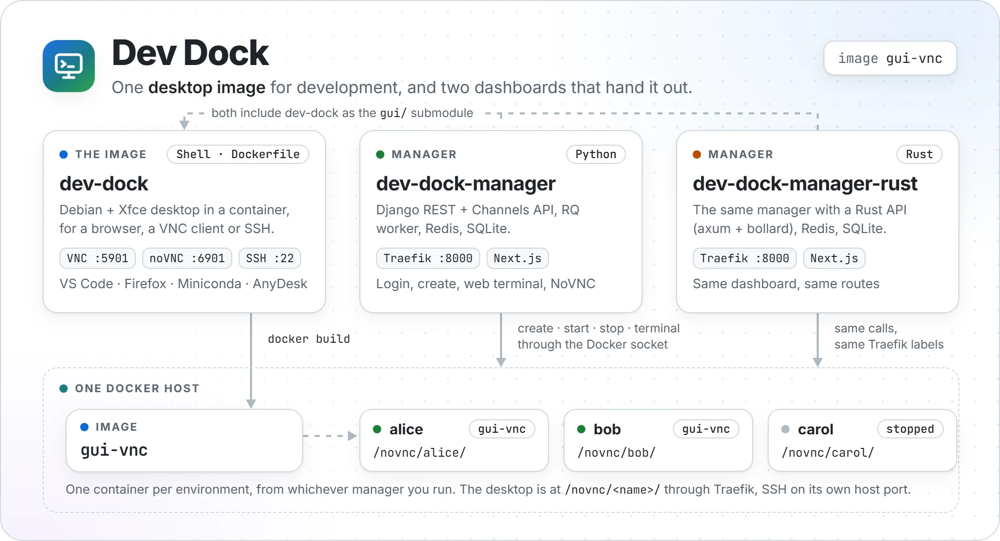
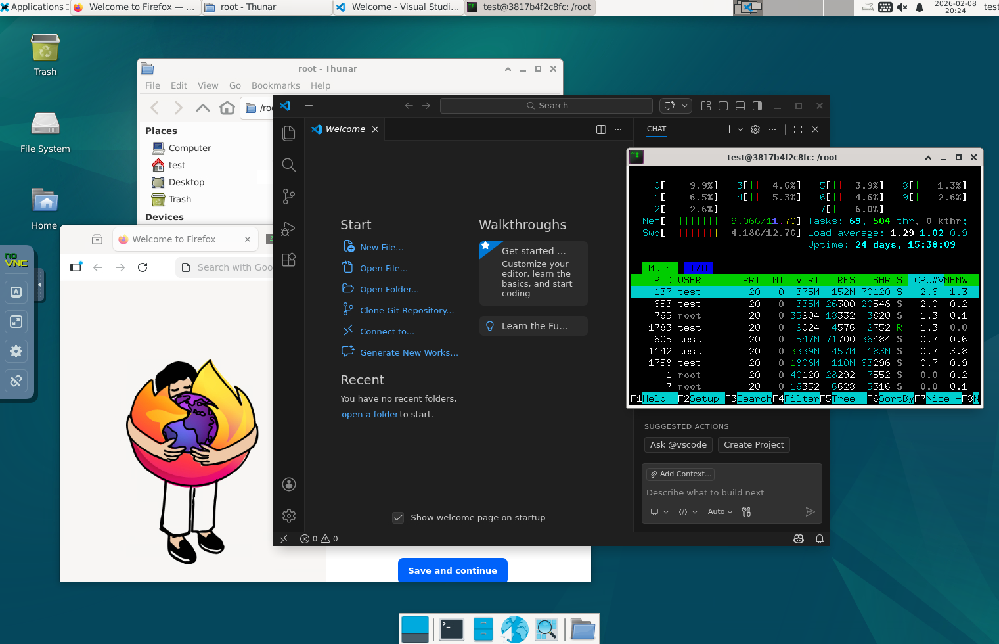
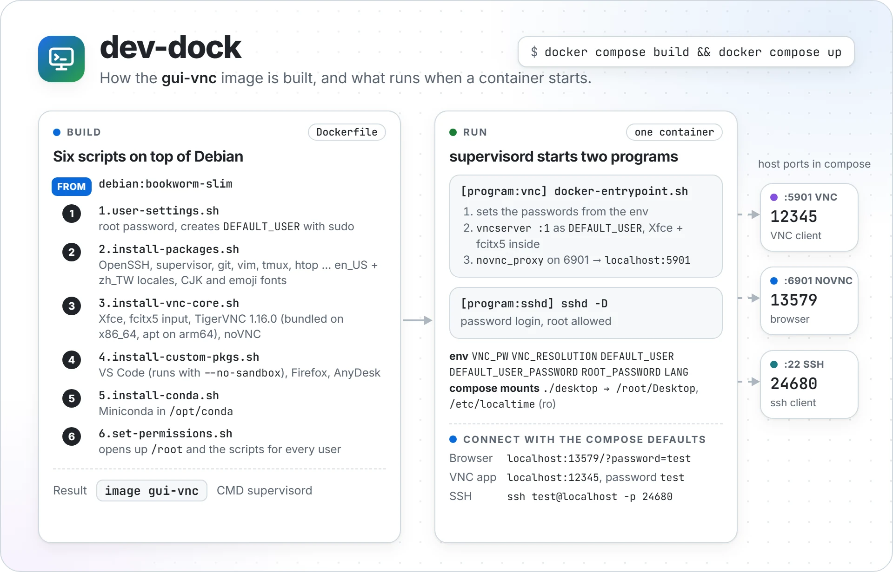

<p align="center">
  <picture>
    <source media="(prefers-color-scheme: dark)" srcset="docs/images/family-dark.webp">
    
  </picture>
</p>

<p align="center">
  <a href="https://hub.docker.com/r/natlee/gui-vnc"></a>
  <a href="./LICENSE"></a>
</p>

# Dev Dock (GUI)

Dev Dock is a Docker image with a whole Linux desktop inside: Xfce on Debian, VS Code, Firefox, Miniconda
and the usual command-line tools. You open the desktop in a browser (noVNC), in any VNC client, or skip the
desktop and SSH in. Build it once, start as many containers as you like, and everyone gets the same dev box.

> Supports **x86_64** and **arm64** (aarch64). Build the image on the same architecture as the host so Firefox
> and VS Code run natively.



## The Dev Dock family

This repo is the image. Two sibling repos turn it into a small self-hosted service where each person
logs in and gets their own desktop container on one machine:

| Repo | What it is |
|---|---|
| **dev-dock** (this repo) | Builds the `gui-vnc` image: desktop, VNC, noVNC and SSH in one container. |
| [dev-dock-manager](https://github.com/NatLee/dev-dock-manager) | Web dashboard with a Django (Python) API. |
| [dev-dock-manager-rust](https://github.com/NatLee/dev-dock-manager-rust) | The same dashboard with a Rust API. |

Both managers include this repo as their `gui/` git submodule and build `gui-vnc` from it. When someone
clicks "create", the manager starts a `gui-vnc` container through the Docker socket, publishes only its SSH
port, and puts its noVNC page behind Traefik (a reverse proxy) at `/novnc/<name>/`. Everything else about
the container is what this README describes.

## How it works

<p align="center">
  <picture>
    <source media="(prefers-color-scheme: dark)" srcset="docs/images/dev-dock-flow-dark.webp">
    
  </picture>
</p>

**Building** runs six scripts on top of `debian:bookworm-slim`, in order: user setup, OS packages and
fonts, the desktop and VNC, VS Code / Firefox / AnyDesk, Miniconda, and permissions. TigerVNC comes from
the bundled `vnc-tools/tigervnc-1.16.0.x86_64.tar.gz` on x86_64 and from Debian's packages on arm64.

**Starting a container** runs `supervisord`, which keeps two programs alive:

- `docker-entrypoint.sh` sets the passwords from the environment, starts the VNC server on display `:1`
  (port 5901) as `DEFAULT_USER`, runs Xfce in it, and starts noVNC on port 6901, which turns the VNC
  session into a web page.
- `sshd` on port 22, with password login. `root` can log in too.

The desktop runs as `DEFAULT_USER`, not as root, so its home is `/home/<DEFAULT_USER>`. Passwords are applied
on every start, so a container picks up new values after you recreate it with different environment
variables.

## What's inside

* **Xfce** desktop (lightweight)
* **TigerVNC** (port 5901) + **noVNC** (port 6901, browser access)
* **OpenSSH** (port 22)
* **VS Code** (launched with `--no-sandbox` for container compatibility)
* **Firefox**
* **AnyDesk**
* **Miniconda** in `/opt/conda`
* **fcitx5** Chinese input (e.g. Pinyin); use `fcitx5-configtool` to add or switch input methods
* Git, vim, tmux, htop and other common dev tools

## Build and run

Build on the **same architecture** as the host (e.g. on Apple Silicon, build there) to avoid
"Dynamic loader not found" for Firefox/VS Code.

```bash
docker compose build
docker compose up -d
```

Be patient with the first build: it downloads a few hundred packages plus VS Code, Firefox and Miniconda.
On an x86_64 machine with Docker 29 a clean build took 10 to 26 minutes depending on download speed, and
the image came out at about 7.8 GB.

With the default `docker-compose.yml` (container name `test`, every password `test`):

| To open | Use |
|---|---|
| Desktop in a browser | `http://localhost:13579/?password=test` |
| Desktop in a VNC client | `localhost:12345`, password `test` |
| A shell | `ssh test@localhost -p 24680`, password `test` |

`./dev-bash.sh` opens a root shell in that container and `./dev-restart.sh` restarts it.

## Pull from Docker Hub

Pre-built images are on [natlee/gui-vnc](https://hub.docker.com/r/natlee/gui-vnc). There are two tags:

| Tag | Architecture | Built |
|---|---|---|
| `20260208-arm64` | arm64 (Apple Silicon, ARM servers) | 2026-02-08 |
| `20241202-x86` | x86_64 | 2024-12-02, from an older version of this repo |

```bash
docker pull natlee/gui-vnc:20260208-arm64

docker run -d \
  -p 12345:5901 -p 13579:6901 -p 24680:22 \
  -v /etc/localtime:/etc/localtime:ro \
  -e VNC_PW=mypassword \
  -e DEFAULT_USER=dev -e DEFAULT_USER_PASSWORD=dev \
  -e ROOT_PASSWORD=root \
  --name gui natlee/gui-vnc:20260208-arm64
```

Then open `http://localhost:13579/?password=mypassword`. For the current version on x86_64, build the image
yourself as shown above.

## NVIDIA GPU

Install [NVIDIA Container Toolkit](https://docs.nvidia.com/datacenter/cloud-native/container-toolkit/latest/install-guide.html) on the host, then use the GPU compose file:

```bash
docker compose -f docker-compose.nvidia.yml build
docker compose -f docker-compose.nvidia.yml up -d
```

## Connection

| Service | Port in the container | How to connect |
|--------|----------------|-----------------|
| VNC    | 5901           | VNC client → `<HOST_IP>:<PORT>` |
| noVNC  | 6901           | Browser → `http://<HOST_IP>:<PORT>/?password=<VNC_PW>` |
| SSH    | 22             | `ssh <user>@<HOST_IP> -p <PORT>` (user: `root` or `DEFAULT_USER`) |

`docker-compose.yml` maps them to host ports **12345** (VNC), **13579** (noVNC) and **24680** (SSH).

## Parameters (environment / run options)

| Variable | Default | Description |
|----------|---------|-------------|
| `VNC_PW` | vncpassword | VNC (and noVNC) password |
| `VNC_RESOLUTION` | 1600x900 | Desktop resolution |
| `VNC_VIEW_ONLY` | false | If true, `VNC_PW` only gets a view-only session (you can watch, not click or type) |
| `DEFAULT_USER` | user | Non-root user the desktop runs as (e.g. AnyDesk needs one) |
| `DEFAULT_USER_PASSWORD` | user | Password for `DEFAULT_USER` |
| `ROOT_PASSWORD` | root | Root password |
| `LANG` | en_US.UTF-8 | Locale (e.g. `zh_TW.UTF-8` for Chinese) |

### Example: docker run

```bash
docker run -d \
  -p 12345:5901 -p 13579:6901 -p 24680:22 \
  -v /etc/localtime:/etc/localtime:ro \
  -v /path/on/host:/root/Desktop \
  -e VNC_PW=mypassword \
  -e VNC_RESOLUTION=1920x1080 \
  -e DEFAULT_USER=dev -e DEFAULT_USER_PASSWORD=dev \
  -e ROOT_PASSWORD=root \
  -e LANG=zh_TW.UTF-8 \
  --name gui gui-vnc
```

Build the image first (from this directory): `docker compose build` → image name is `gui-vnc`.

A folder mounted under `/root` (like `/root/Desktop` above, or `./desktop` in `docker-compose.yml`) is
root's. You reach it over SSH as root or from a root shell. It does not show up on the VNC desktop, because
that desktop belongs to `DEFAULT_USER`.

### Useful run options

* Map ports: `-p 12345:5901 -p 13579:6901 -p 24680:22`
* Timezone: `-v /etc/localtime:/etc/localtime:ro`
* Mount folder: `-v <HOST_PATH>:<CONTAINER_PATH>`

## License

[MIT](./LICENSE)
